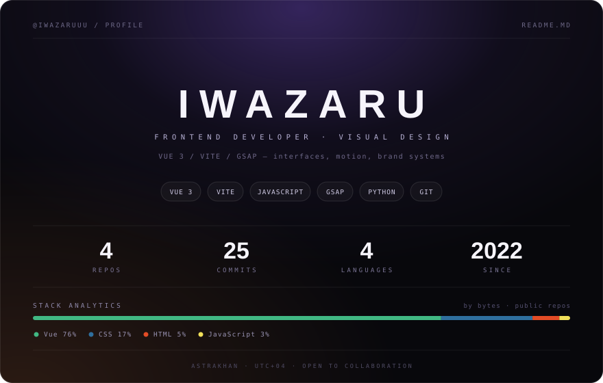

  

Фронтенд на Vue 3: интерфейсы, анимация, аккуратная типографика. Рядом — графика и бренд-визуал: от макета до готовой вёрстки.

## Чем занимаюсь

Собираю интерфейсы на Vue 3 + Vite, движение и скролл-сценарии — на GSAP.

Делаю бренд-графику: логотипы, оформление сообществ и стримеров, афиши, SMM-макеты.

Пишу внутренние инструменты — разбор выгрузок, автоматизация на Python.

## Проекты

| Проект | Что это | Стек | Год |
| :--- | :--- | :--- | ---: |
| [Iwazaru Portfolio](https://iwazaruuu.github.io/Iwazaru-PR/) | одностраничник-портфолио с GSAP-анимациями, живой на GitHub Pages | Vue 3 · Vite · GSAP | 2026 |
| [OverDice](https://iwazaruuu.github.io/OverDice) | статический лендинг, собранный и выложенный на GitHub Pages | HTML · CSS · JS | 2022 |
| [pricelist_comparison](https://github.com/Iwazaruuu/pricelist_comparison) | прототип сравнения прайс-листов: формы, разбор данных | Vue 3 · Vite | 2025 |
| [Test_idem](https://github.com/Iwazaruuu/Test_idem) | эксперименты с Vue и сборкой | Vue 3 | 2022 |

## Стек

**Фронтенд** — Vue 3, Vite, JavaScript, GSAP, CSS
**Дизайн** — Photoshop, Illustrator
**Ещё** — Python, Git, Docker, Linux

## Связь

- GitHub — [@Iwazaruuu](https://github.com/Iwazaruuu)
- Портфолио — [iwazaruuu.github.io/Iwazaru-PR](https://iwazaruuu.github.io/Iwazaru-PR/)

